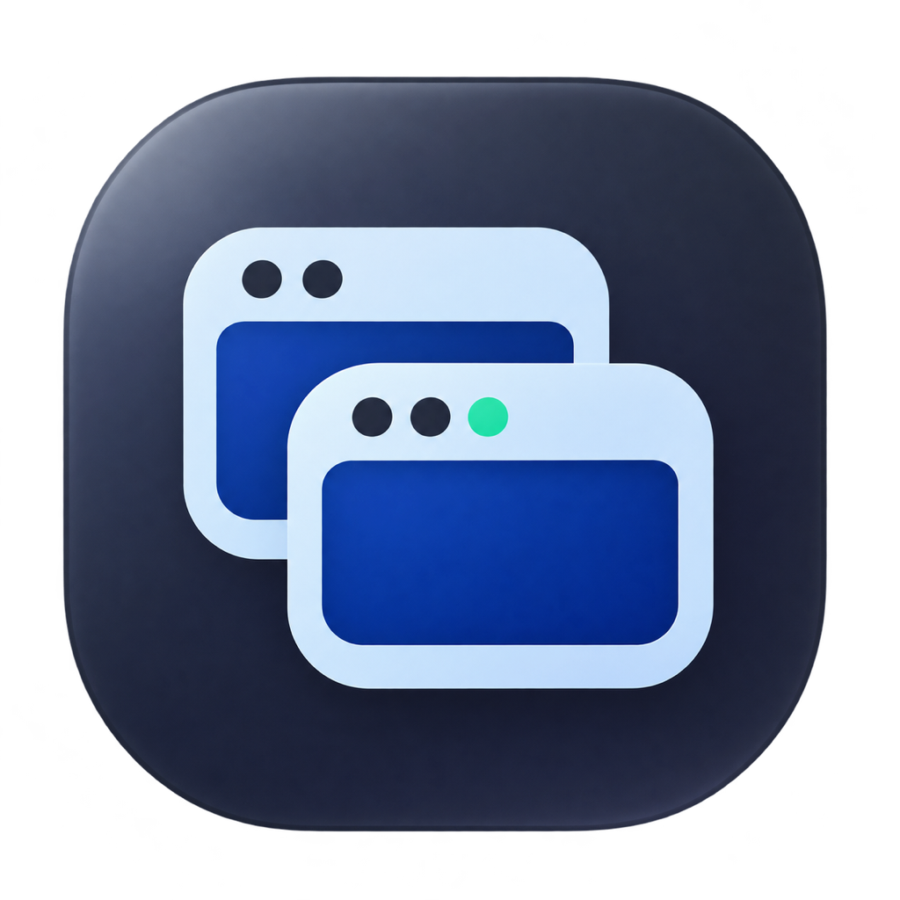

<p align="center">
  
</p>

<h1 align="center">AnyBrowser</h1>

<p align="center">
  <strong>面向 Apple Silicon 的 Chromium 多 Profile 工作台</strong><br />
  在一个 macOS 窗口里管理独立浏览器资料、可复现的指纹配置和本机 DevTools 端口。
</p>

<p align="center">
  
  
  
</p>

<p align="center">
  <a href="#核心能力">核心能力</a> ·
  <a href="#快速开始">快速开始</a> ·
  <a href="#日常使用">日常使用</a> ·
  <a href="#本机数据">本机数据</a> ·
  <a href="#开发与测试">开发与测试</a> ·
  <a href="https://github.com/riba2534/anybrowser/issues">问题反馈</a>
</p>

---

AnyBrowser 是一个原生 macOS 应用。每个 Profile 对应一份 Chromium 资料目录和一组启动参数，可以同时运行。项目将经过校验的 [Fingerprint Chromium](https://github.com/adryfish/fingerprint-chromium) 打进应用包，启动时由 AnyBrowser 选择对应的资料目录和配置。

## 核心能力

| 功能 | 说明 |
| --- | --- |
| **独立 Profile** | 分开保存 Cookie、历史、扩展和站点存储。可同时打开多个实例，单独停止或重启。 |
| **指纹配置** | 可编辑平台、浏览器品牌及其版本、逻辑 CPU 数、语言、时区和种子。字体、音频、Canvas、元素坐标和 WebGL 参数可按项控制。 |
| **按字段随机生成** | 勾选需要变化的字段并预览结果。保存后，每次启动使用同一份配置。 |
| **独立代理** | 每个 Profile 可设置 HTTP、HTTPS 或 SOCKS5 代理，默认使用本机的 `127.0.0.1:7890`。 |
| **通行密钥** | 每个 Profile 默认加载 Passkey Box。匹配网站凭据后，通过设备验证即可继续注册或登录。 |
| **本机调试** | 每个 Profile 分配一个独立的回环端口，建议从 9222 开始，也可自行修改。端口就绪后可以复制连接地址。 |

## 快速开始

需要 **Apple Silicon Mac 和 macOS 12+**。可以下载 [GitHub Release](https://github.com/riba2534/anybrowser/releases/latest) 的 ARM64 安装包。自行构建需要 Swift 5.9+。

```bash
git clone https://github.com/riba2534/anybrowser.git
cd anybrowser
./scripts/build-app.sh
open dist/AnyBrowser.app
```

首次构建会下载并校验固定版本的引擎和扩展，随后复用本地缓存。构建产物 `dist/AnyBrowser.app` 内置 [Fingerprint Chromium 148.0.7778.215](https://github.com/adryfish/fingerprint-chromium/releases/tag/148.0.7778.215) 和 [Passkey Box v0.2.0](https://github.com/riba2534/passkey-box/releases/tag/v0.2.0)，采用本机 ad-hoc 签名。

## 日常使用

1. 点击左侧「新建 Profile」，输入名称和端口。
2. 手动编辑指纹，或通过「随机生成」勾选要变化的字段，再查看预览。
3. 点击「保存并启动」。调试就绪后，可复制类似 `http://127.0.0.1:9222` 的 DevTools 地址。
4. 编辑正在运行的 Profile 后，重启该实例应用新配置。

在「浏览器指纹」里填写代理地址。默认的 `127.0.0.1:7890` 按 HTTP 代理连接，适用于开放相应端口的 Mihomo 设置。也可填入完整的代理地址，例如 `socks5://127.0.0.1:7891`。留空时使用系统网络设置。升级后，之前没有代理字段的 Profile 也预填默认地址。

网页实际读到的内存和 WebGL 参数由内置引擎根据平台与种子决定。支持范围随引擎版本变化。调试端口仅用于本机连接，启动器会校验监听进程和具体的 Profile。

### 使用 Passkey Box

启动 Profile 后，在 Chromium 扩展菜单里打开 Passkey Box。服务器地址已预填为 `https://password.riba2534.cn/`。在每个 Profile 登录一次，再到「设置 → 设备验证」添加受信设备。网站发起通行密钥请求时，插件会匹配凭据。在验证窗口确认网站并通过本机生物识别或 FIDO2 安全密钥验证后，插件会自动提交签名。

Profile 重启后会加载内置扩展并保留该 Profile 的扩展设置。Chromium 的本机调试端口可以控制该 Profile，请仅交给受信的本机程序使用。

## 本机数据

| 路径 | 内容 |
| --- | --- |
| `~/Library/Application Support/AnyBrowser/profiles.sqlite3` | Profile 配置、指纹参数和端口 |
| `~/Library/Application Support/AnyBrowser/Profiles/<UUID>/` | 对应 Profile 的 Chromium 用户资料 |

从界面移除一条 Profile 记录后，原有浏览器资料仍可在上述目录找到。

## 开发与测试

| 目录 | 内容 |
| --- | --- |
| [Sources/AnyBrowser/](Sources/AnyBrowser/) | SwiftUI 界面 |
| [Sources/AnyBrowserCore/](Sources/AnyBrowserCore/) | Profile 存储、参数和浏览器进程管理 |
| [Resources/](Resources/) | Logo、应用元数据和引擎许可 |
| [Tests/](Tests/) | 单元测试和真实浏览器集成测试 |

```bash
swift test --arch arm64
ANYBROWSER_TEST_APP="$PWD/dist/AnyBrowser.app" swift test --arch arm64
```

第二条命令需要提前构建应用、登录 macOS 图形会话，并预留本机端口 9222 和 9223。它启动两个临时 Profile，验证调试端点、代理、站点存储隔离、Passkey Box 预填地址与扩展存储隔离，以及重启恢复。

## 贡献

欢迎提交 [Issue](https://github.com/riba2534/anybrowser/issues) 或 Pull Request。反馈运行问题时，请附上 macOS 版本、内置引擎版本、复现步骤和错误信息。

## 致谢与许可

内置引擎来自 [Fingerprint Chromium](https://github.com/adryfish/fingerprint-chromium)，基于 Ungoogled Chromium。BSD 3-Clause 许可随应用包分发，见 [第三方许可](Resources/FingerprintChromium.LICENSE.txt)。[Passkey Box](https://github.com/riba2534/passkey-box) 的 MIT 许可及依赖许可也随包分发。AnyBrowser 源码许可尚未在本仓库声明。
